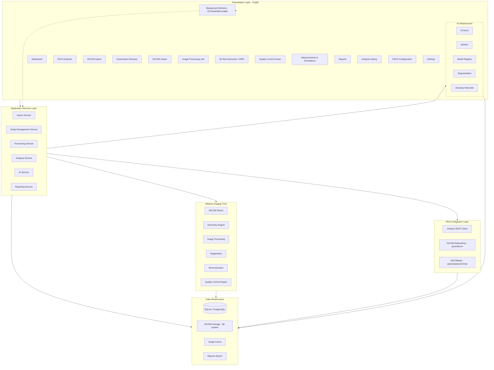
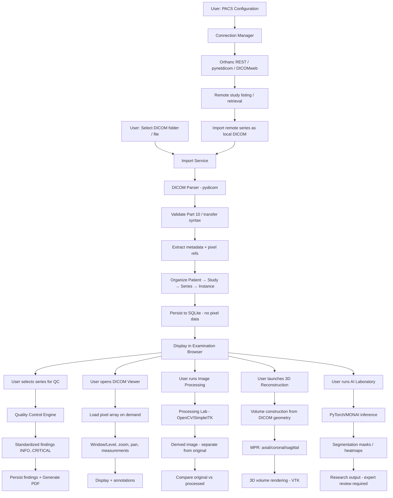
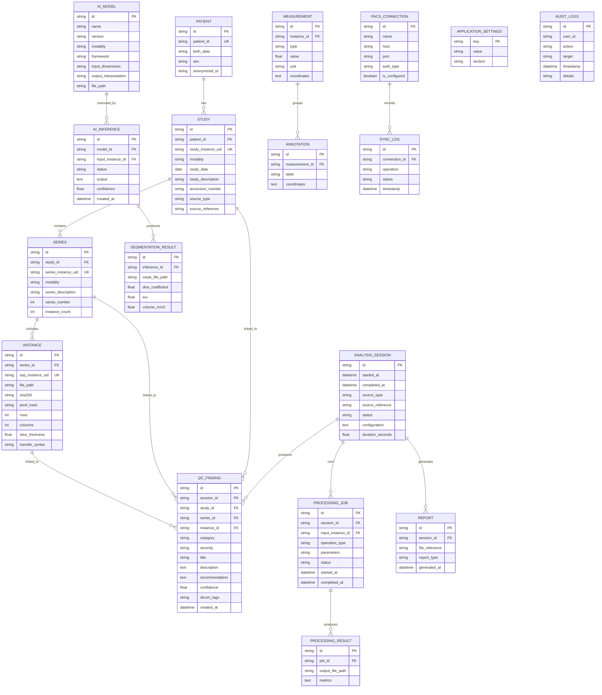
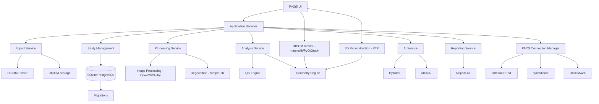

# DICOM Ghost Hunter — Professional Software Architecture

## 1. System Architecture Diagram (Mermaid)

## 2. Data-Flow Diagram (Mermaid)

## 3. Database Entity Relationship Diagram (Mermaid)

## 4. Module Dependency Diagram (Mermaid)

## 5. Selected Libraries and Roles

| Library | Role | Justification |
|---------|------|---------------|
| Python 3.12 | Main language | Target environment, type hints, performance |
| PyQt5 | Desktop UI | Professional desktop, mature, Windows-compatible |
| pydicom | DICOM parsing | Reference DICOM library, Part 10 support |
| pynetdicom | DICOM networking | C-STORE, C-FIND, C-MOVE, C-GET |
| requests/httpx | Orthanc REST API | HTTP client for Orthanc |
| NumPy | Numerical processing | Array operations, pixel manipulation |
| OpenCV | Image processing | Filters, morphology, edge detection |
| SciPy | Scientific computing | Signal processing, interpolation |
| SimpleITK | Medical image processing | Registration, resampling, medical I/O |
| VTK | 3D visualization | Volume rendering, MPR, surface extraction |
| matplotlib | 2D visualization | Embedded in PyQt5, viewer backend |
| PyQtGraph | Alternative visualization | High-performance interactive plots |
| SQLAlchemy | ORM | SQLite now, PostgreSQL migration path |
| SQLite | Local database | Zero-config, file-based, Windows-compatible |
| ReportLab | PDF generation | Professional reports |
| PyYAML | Configuration | Human-readable YAML config |
| pytest | Testing | Unit and integration tests |
| Ruff | Code quality | Fast linting and formatting |
| Python logging | Logging | Structured, production-ready |
| PyTorch | Deep learning | AI segmentation / anomaly detection |
| MONAI | Medical AI | Medical imaging AI frameworks |
| PyInstaller | Packaging | Windows executable distribution |

## 6. Technical Feasibility Evaluation

| Component | Feasibility | Notes |
|-----------|-------------|-------|
| DICOM import & parsing | High | pydicom is mature and well-tested |
| Local SQLite database | High | SQLAlchemy + SQLite is straightforward |
| PyQt5 desktop UI | High | Mature, Windows-compatible, used in medical software |
| DICOM viewer (2D) | High | matplotlib + PyQt5 works well |
| Window/Level, zoom, pan | High | Standard matplotlib interactions |
| Measurements (distance, angle, ROI) | Medium | Requires PixelSpacing calibration |
| Orthanc REST integration | High | Well-documented REST API |
| pynetdicom C-STORE/C-FIND | Medium | Requires network configuration, AE titles |
| DICOMweb | Medium | Depends on Orthanc DICOMweb plugin |
| Image processing (filters, morphology) | High | OpenCV + SciPy are robust |
| Image registration | Medium | SimpleITK is good but complex to configure |
| MPR / 3D reconstruction | Medium | VTK has steep learning curve; geometry math required |
| 3D volume rendering | Medium | VTK + PyQt5 integration is non-trivial |
| PyTorch / MONAI AI | Medium | Large dependencies, GPU optional, CPU fallback |
| PDF reporting | High | ReportLab is reliable |
| Synthetic DICOM generation | High | pydicom can create test files |

## 7. Realistic MVP Definition

The MVP (Phase 1-3) must be runnable and tested:

1. **Foundation**: PyQt5 shell, dashboard, navigation, logging, configuration, SQLite initialization, theme system.
2. **DICOM Import**: Single file and folder import, validation, duplicate detection (SHA-256 + pixel hash).
3. **Database**: Patient → Study → Series → Instance hierarchy, no pixel data in DB.
4. **DICOM Viewer**: Axial view, slice navigation, Window/Level, zoom, pan, metadata overlay.
5. **Quality Control**: Metadata validation, duplicate detection, slice continuity, orientation, geometry, privacy inspection.
6. **PACS**: Orthanc REST connection, test, study/series listing (optional, Workflow B).
7. **Reporting**: PDF QC report via ReportLab.
8. **Testing**: 25+ unit tests, synthetic DICOM generator, ruff clean.

**Out of MVP**: AI laboratory, 3D volume rendering, image processing lab, measurements, PostgreSQL, DICOM networking (C-STORE/C-FIND), DICOMweb.

## 8. Detailed Development Roadmap

| Phase | Modules | Deliverables |
|-------|---------|--------------|
| 1 | Foundation | PyQt5 shell, dashboard, navigation, logging, config, SQLite, theme |
| 2 | DICOM & PACS core | Import, parser, organization, metadata, browser, Orthanc REST |
| 3 | DICOM Viewer | 2D visualization, navigation, Window/Level, measurements, metadata |
| 4 | Image Processing Lab | Filters, denoising, enhancement, edge detection, morphology, frequency |
| 5 | 3D Reconstruction | Volume construction, MPR, volume rendering, surface extraction |
| 6 | Quality Control | Full QC engine, SNR/CNR, privacy, integrity |
| 7 | AI Laboratory | PyTorch/MONAI, model registry, segmentation, anomaly detection |
| 8 | Reporting & Management | PDF/CSV/JSON export, history, audit logs, backup |
| 9 | Testing & Optimization | Validation, performance, packaging, documentation |

## 9. Technical Risks and Mitigations

| Risk | Impact | Mitigation |
|------|--------|------------|
| VTK/PyQt5 integration instability | High | Isolate 3D in separate widget; provide fallback to 2D MPR |
| Large DICOM memory usage | High | Load pixels on demand; cache only active slices; never load full volume into RAM |
| pynetdicom network complexity | Medium | Make PACS networking optional; REST-first via Orthanc |
| PyTorch/MONAI large install | Medium | Optional dependency group; CPU-only models for MVP |
| Universal QC thresholds invalid | High | Configurable thresholds per modality/protocol; no hardcoded clinical limits |
| Incorrect geometry reconstruction | High | Use ImageOrientationPatient + ImagePositionPatient; test with synthetic oblique data |
| GUI freezing during import/analysis | High | All heavy work in QThread/QRunnable workers with progress + cancellation |
| Patient data in logs | High | De-identified logging; never log PatientName/PatientID |
| Windows dependency conflicts | Medium | Loose version pins; test in clean venv |

## 10. TCIA and Synthetic DICOM Data Strategy

- **TCIA**: Use public CT/MRI collections (e.g., NSCLC, LiTS, or similar) for real-data validation. Respect TCIA data use agreements; never modify original datasets.
- **Synthetic DICOM**: Generate with pydicom in `tests/synthetic_dicom/` for known conditions: normal series, duplicates, missing metadata, invalid UIDs, irregular spacing, inconsistent orientation, corrupted files, different dimensions.
- Never modify original research datasets to create test anomalies.

## 11. Orthanc Integration Strategy

- **Mode A (Standalone)**: Local import only; Orthanc not required.
- **Mode B (PACS)**: Orthanc REST API via `requests`/`httpx`; connection test, study/series/instance listing, download instances for local analysis.
- **Future**: pynetdicom C-STORE/C-FIND/C-MOVE/C-GET; DICOMweb QIDO-RS/WADO-RS/STOW-RS.
- Configuration via `.env` and `config/qc_rules.yaml`; no hard-coded credentials; timeouts and SSL verification supported.
